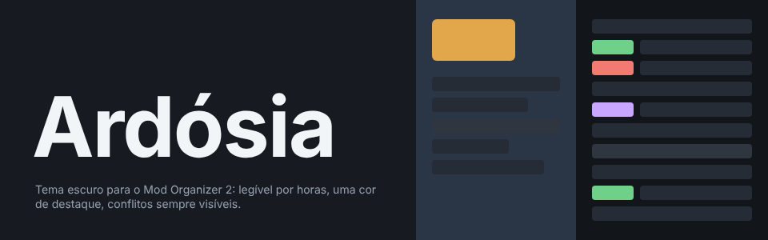
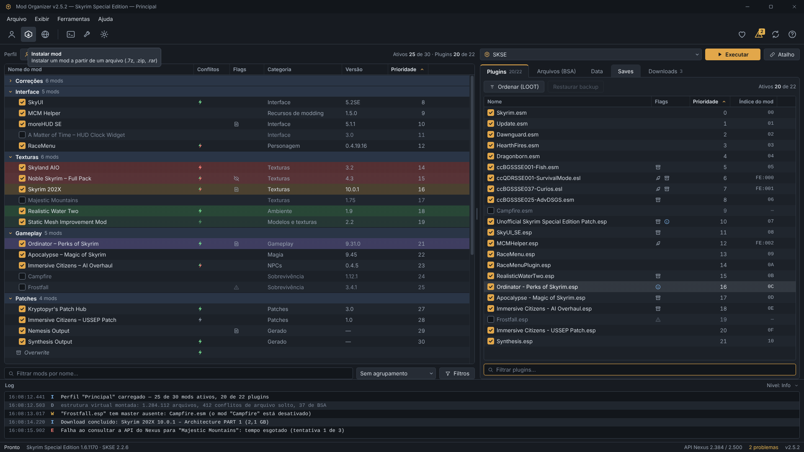
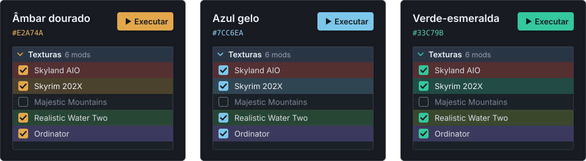
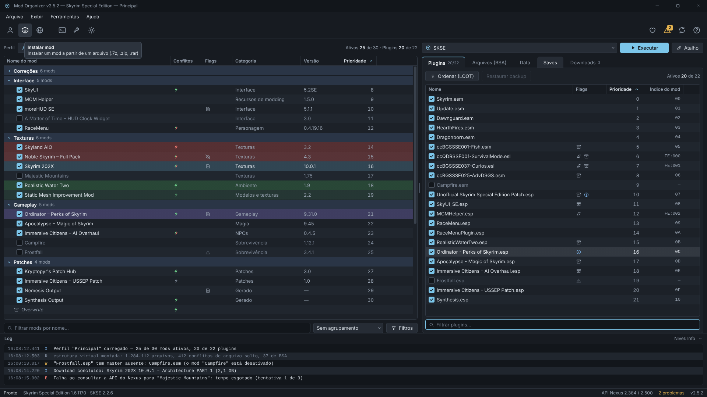
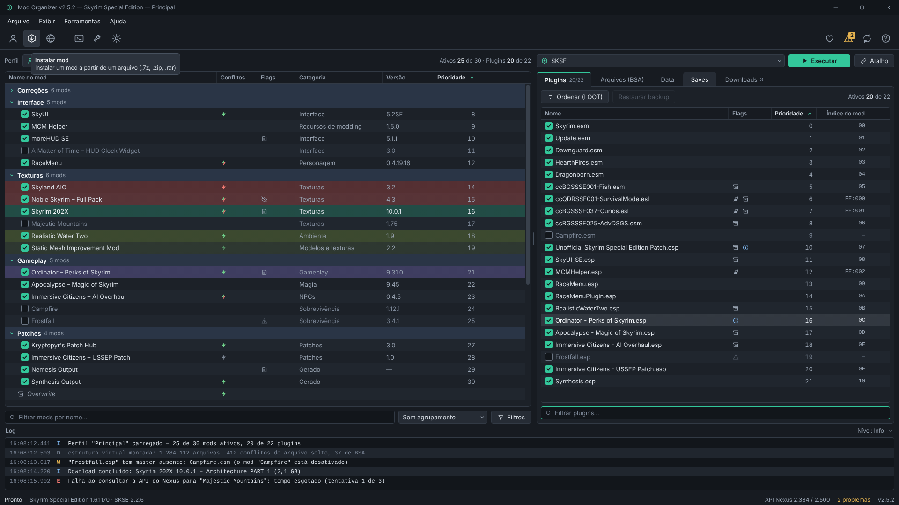
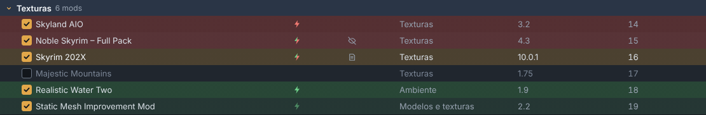
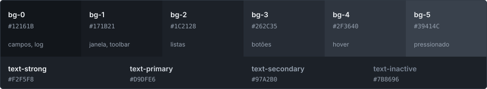

<div align="center">



<br>

**Um tema escuro para o [Mod Organizer 2](https://github.com/ModOrganizer2/modorganizer), feito para sessões longas de modding.**<br>
Base cinza-azulada, uma única cor de destaque e os conflitos sempre à vista.

<br>

[](https://github.com/ldallacqua/ardosia-mo2/archive/refs/heads/main.zip)
[](https://github.com/ModOrganizer2/modorganizer)
[](#três-acentos-uma-base)

[Instalação](#instalação) · [Acentos](#três-acentos-uma-base) · [Conflitos](#conflitos-à-vista) · [Paleta](#paleta) · [Limites](#limites-conhecidos)

</div>

<br>



> [!NOTE]
> As imagens são mockups de design, não capturas do MO2 rodando. Fontes, tamanhos e os ícones de outros botões podem variar na sua instalação.

## Por que Ardósia

- **Confortável por horas.** A base é cinza-azulada, nunca preto puro, com texto principal em contraste de 12,1:1 sobre as listas.
- **As cores do MO2 mandam.** O tema não define fundo para os itens da lista, nem em hover. Só a seleção tem fundo próprio, então as cores de conflito continuam aparecendo.
- **Destaque com moderação.** O acento aparece só onde importa: botão Executar, checkbox marcado, aba ativa, foco, seta de ordenação e seta dos separadores.
- **Estrutura de relance.** Os separadores têm um tom próprio e seta na cor de destaque, e os mods desativados ficam esmaecidos, mas legíveis.
- **Barra de ferramentas própria.** Os ícones coloridos do MO2 dão lugar a desenhos em linha, em um único tom.
- **Estados sempre visíveis.** Todo controle tem hover, pressionado, foco e desabilitado.

## Três acentos, uma base

Só o destaque e a seleção mudam entre as versões. O resto é idêntico, então dá para trocar sem reaprender nada. No Esmeralda, o verde de "sobrescreve" puxa para o lima, para não se confundir com a seleção.

<p align="center">
  
</p>

<table>
  <tr>
    <th width="50%">Azul gelo</th>
    <th width="50%">Verde-esmeralda</th>
  </tr>
  <tr>
    <td><a href="docs/screenshots/MainWindow-gelo.png"></a></td>
    <td><a href="docs/screenshots/MainWindow-esmeralda.png"></a></td>
  </tr>
</table>

## Conflitos à vista

As cores de conflito são translúcidas, então somam com a alternância de linhas em vez de esconder a lista. Com um mod selecionado, a leitura é direta:

<p align="center">
  
</p>

| Linha | Significado |
|---|---|
| 🟥 Vermelha | Perde: o mod selecionado sobrescreve esta linha |
| 🟩 Verde | Ganha: esta linha sobrescreve o mod selecionado |
| 🟪 Violeta | Mod ou plugin relacionado ao item selecionado na outra lista |

As variantes para arquivos BSA usam os mesmos tons, mais suaves.

> [!IMPORTANT]
> O padrão do MO2 é o contrário: verde para quem perde e vermelho para quem ganha. Se preferir o jeito tradicional, troque os valores de *Is overwriting* e *Is overwritten* na tabela abaixo.

## Instalação

**1. Copie os arquivos.** [Baixe o .zip](https://github.com/ldallacqua/ardosia-mo2/archive/refs/heads/main.zip) e copie o conteúdo de `stylesheets/` (os três `.qss` e a pasta `ardosia/`) para a pasta `stylesheets/` do seu MO2, a mesma que fica ao lado do `ModOrganizer.exe`.

**2. Escolha o tema.** Em **Settings › Theme › Style**, selecione `Ardosia Ambar`, `Ardosia Gelo` ou `Ardosia Esmeralda`.

**3. Ajuste as cores.** As cores de conflito são do MO2 e não fazem parte do `.qss`. Defina-as em **Settings › Theme › Colors**, informando o hex e o canal Alfa no seletor de cor:

| Cor no MO2 | Âmbar e Gelo | Esmeralda |
|---|---|---|
| Is overwriting (loose files) | `#50BE64` · alfa `61` | `#A0C846` · alfa `61` |
| Is overwritten (loose files) | `#E8564E` · alfa `71` | `#E8564E` · alfa `71` |
| Is overwriting (archives) | `#50BE64` · alfa `28` | `#A0C846` · alfa `28` |
| Is overwritten (archives) | `#E8564E` · alfa `31` | `#E8564E` · alfa `31` |
| Mod contains selected file | `#9680F0` · alfa `66` | `#9680F0` · alfa `66` |
| Plugin is contained in selected mod | `#9680F0` · alfa `66` | `#9680F0` · alfa `66` |

*Plugin is master of selected plugin* não faz parte do tema e pode ficar como está.

**4. Pinte os separadores.** A cor de separador é definida em cada um: selecione os separadores, clique com o botão direito e use **Select Color...** com `#2A3546`. O MO2 reaplica a última cor usada nos separadores novos. Para ter a seta na cor de destaque, ative os separadores recolhíveis em **Settings › Mod List › Collapsible Separators**.

**5. Escureça a barra de título (opcional).** Ela é nativa do Windows e fica fora do QSS. Para pintá-la nas cores do tema, copie `plugin/ArdosiaTitleBar.py` para a pasta `plugins/` do MO2 e reinicie o programa. A cor exata exige Windows 11, e o plugin só age com um tema Ardósia ativo.

**6. Instale a fonte (opcional).** O tema prefere a [Inter](https://github.com/rsms/inter/releases/latest), gratuita, e usa a Segoe UI se ela não estiver instalada. Baixe o `.zip`, instale `InterVariable.ttf` e `InterVariable-Italic.ttf` e reinicie o MO2.

**7. Suavize o texto (opcional).** O motor de fontes padrão pode deixar a Inter com bordas duras. Para usar o FreeType, copie `extras/MO2 FreeType.cmd` para a pasta do `ModOrganizer.exe` e abra o MO2 por esse arquivo, ou por um atalho para ele. Abrindo o `ModOrganizer.exe` direto, o MO2 volta ao motor padrão. O `qt.conf` não funcionou no MO2 2.5.2.

> [!TIP]
> Se os ícones não aparecerem (checkbox marcado sem o check, setas faltando), troque `url(./ardosia/` por `url(./stylesheets/ardosia/` no `.qss`.

## Paleta

<p align="center">
  
</p>

| Token | Âmbar | Gelo | Esmeralda |
|---|---|---|---|
| `accent` | `#E2A74A` | `#7CC6EA` | `#33C79B` |
| `accent-hover` | `#ECB965` | `#98D3F0` | `#52D4AD` |
| `accent-pressed` | `#C48D34` | `#5DAED6` | `#27A882` |
| `accent-text` | `#E9B35E` | `#8DCDEE` | `#4FD1AA` |

Tipografia, espaçamento, raios e todos os tokens estão no [guia de design](design/GUIA.md). A especificação de cada seletor está na [referência QSS](design/qss-reference.md).

## Limites conhecidos

- O QSS não consegue mirar só as linhas de separador. O destaque delas vem da cor de separador do MO2 e da seta de acento em `::branch`.
- O texto esmaecido dos mods desativados e os ícones das colunas Conflitos e Flags são desenhados pelo próprio MO2.
- A barra de título é nativa do Windows e fica fora do QSS. Sem o plugin opcional, ela segue o padrão do sistema.
- Os nomes de objeto usados pelo tema (`#logList`, `#startButton`) são os do MO2 2.4 e 2.5.

<details>
<summary><strong>Estrutura do repositório</strong></summary>

```
stylesheets/            .qss compilados + ícones (o que vai para o MO2)
plugin/                 plugin opcional que pinta a barra de título
extras/                 atalho opcional que abre o MO2 com o FreeType
design/
  tokens.json           fonte da verdade: cores (3 temas), tipografia, espaçamento, raios, dimensões
  tokens.css            variáveis CSS geradas (para as prévias)
  GUIA.md               guia de design: paleta, tipografia, princípios, limites do QSS
  qss-reference.md      especificação seletor por seletor, fonte dos .qss
  ICONES.md             descrição dos ícones
  icons/                ícones SVG (exportados em 64px)
  components/           prévias HTML (mockups + estados de cada componente) e bundle.css
scripts/                geradores (Python 3)
docs/                   prévias autônomas em HTML (abra docs/index.html), screenshots e imagens do README
```

</details>

<details>
<summary><strong>Reconstruir a partir do código</strong></summary>

Requisitos: Python 3.9+. Para gerar PNGs, também `pip install playwright` e `playwright install chromium`.

```bash
python scripts/build_all.py          # tokens -> ícones -> prévias -> .qss -> docs/
python scripts/build_all.py --png    # + capturas PNG em docs/
```

- Para mudar uma cor do tema, edite `design/qss-reference.md` e a tabela de substituição em `scripts/build_qss.py`. Depois rode `python scripts/build_qss.py`.
- Para mudar uma cor nas prévias, edite `scripts/build_tokens.py`, que gera `tokens.json` e `tokens.css`.

</details>

## Licença

[MIT](LICENSE)
